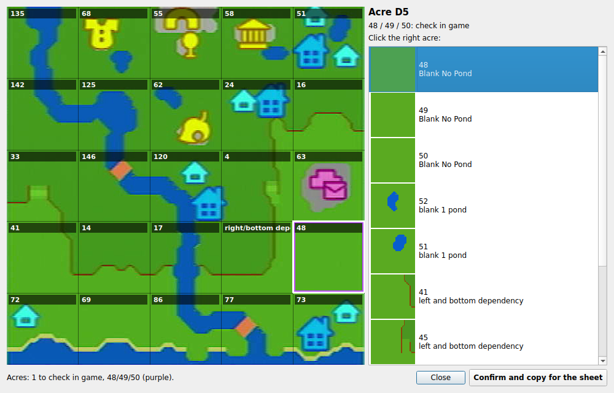
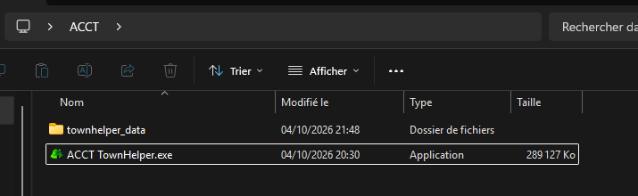
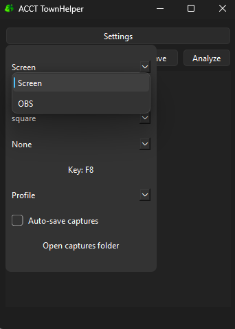
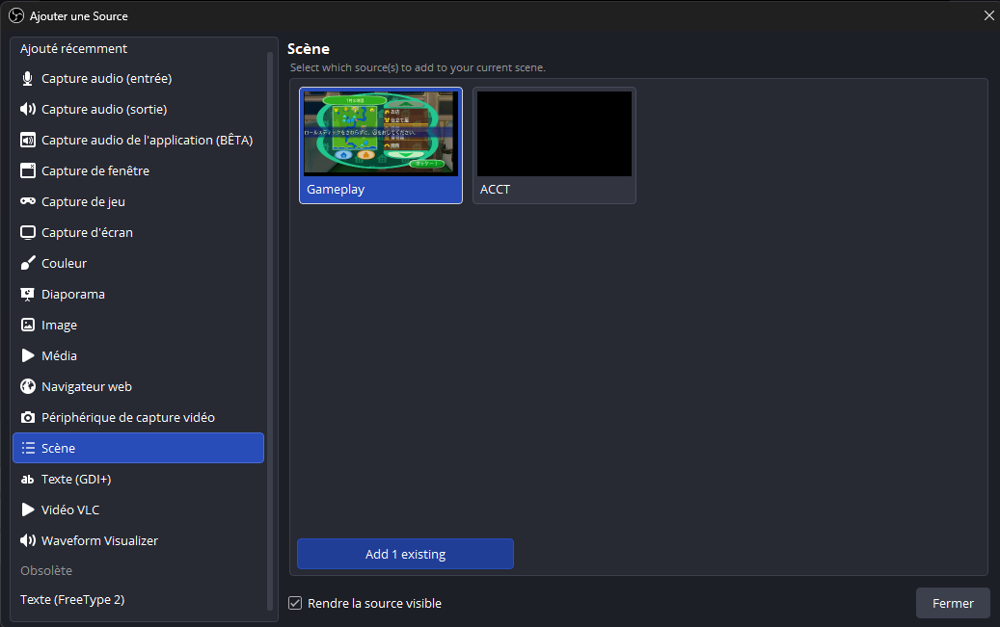
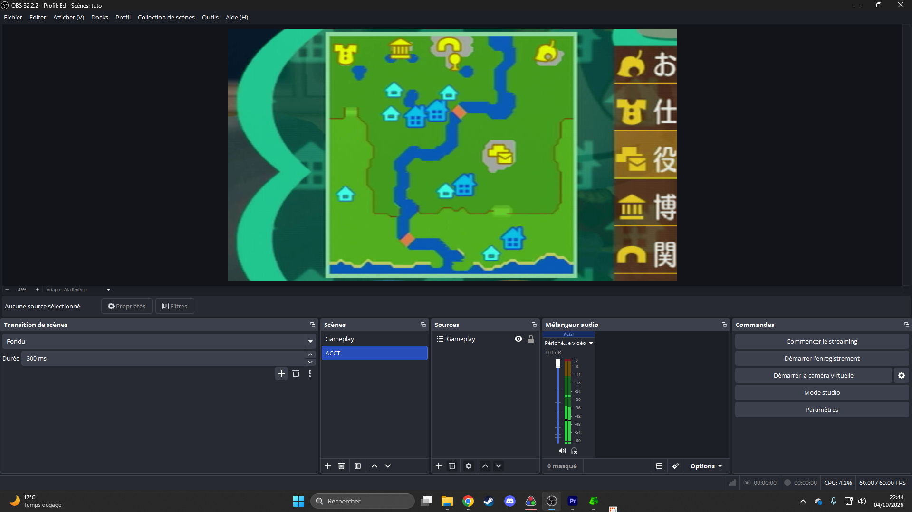
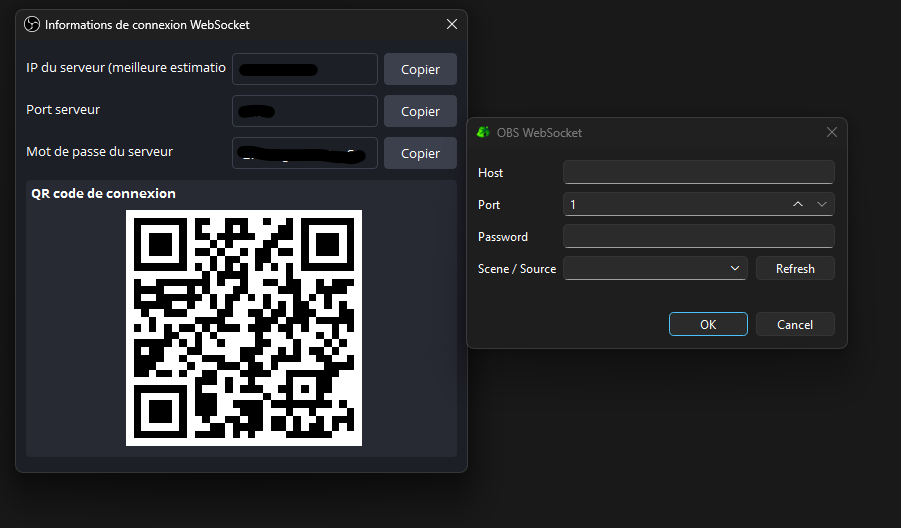
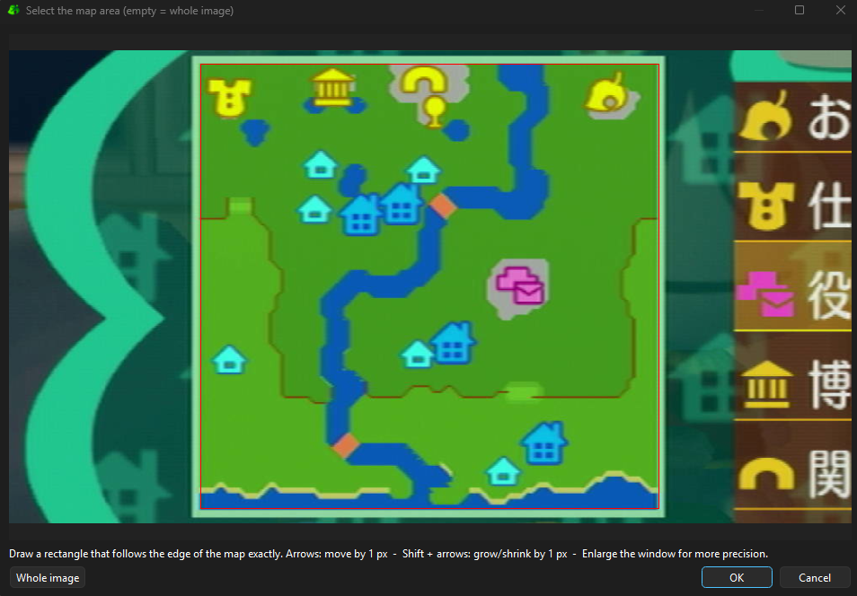
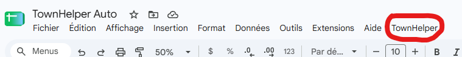
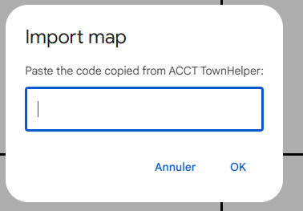
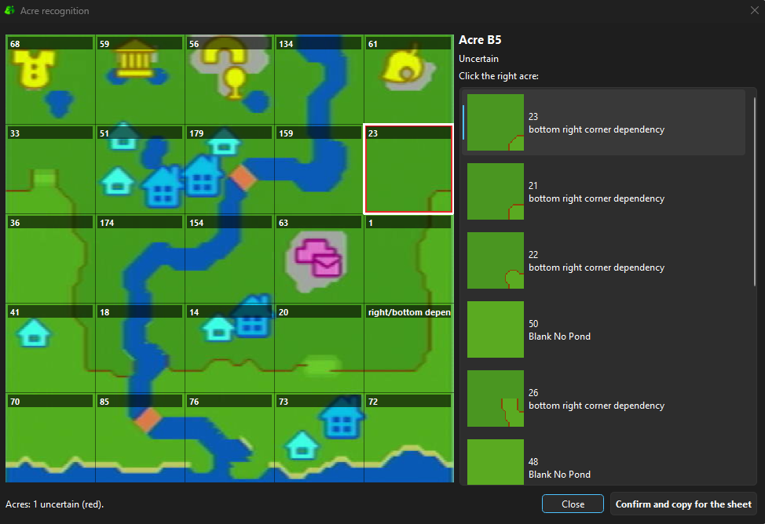

# ACCT TownHelper

**Automatic town map recognition for Animal Crossing: City Folk.**

Capture your town map, click **Analyze**, and ACCT TownHelper identifies the 25 acres of your town and fills the *CF TownHelper* Google Sheet for you, instead of rebuilding your map by hand during the intro and chores.

> [!NOTE]
> **This tool could not exist without the work of frobuddyharry.**
> Every acre the tool recognises, along with its trees, flowers and spots to plant, comes from frobuddyharry's **CF TownHelper** document and its listing of every City Folk acre. ACCT TownHelper only automates the step of finding which acres are in your town.



## ⬇️ Download

Get the latest version on the **[Releases page](../../releases/latest)**, then follow the tutorial below.

## Features

- **Captures your town map** from an OBS scene (recommended) or from an area of your screen.
- **Recognises all 25 acres** in a few seconds, using building icons, house positions, bridges and whole-map rules (one Town Hall, rivers that connect, two ramps…).
- **Lets you review and fix** the result in one click.
- **Fills the Google Sheet** with a single paste.
- **Learns from you**: every map you confirm makes the next ones more accurate on your own setup.

## Tutorial

1. [What you need](#1-what-you-need)
2. [Basic setup](#2-basic-setup)
3. [Choose your capture method](#3-choose-your-capture-method)
4. [Set up the OBS method (recommended)](#4-set-up-the-obs-method-recommended)
5. [Set up the Screen method](#5-set-up-the-screen-method)
6. [Prepare the Google Sheet](#6-prepare-the-google-sheet)
7. [Acre recognition!](#7-acre-recognition)
8. [Important things to know](#8-important-things-to-know)

For developers: [build from source and technical notes](#for-developers).

---

## 1. What you need

- **ACCT TownHelper.exe** and the **`townhelper_data`** folder, available on the [Releases page](../../releases/latest).
- **A copy of [this Google Sheet](https://docs.google.com/spreadsheets/d/1TKBXJh7_-HTV9Dox8sbMDreySi8oT5DSVuWm4K-H7j4/copy)**: frobuddyharry's CF TownHelper document, with the import script already included. The link opens a **Make a copy** page directly.
- Windows.
- For the recommended method: **OBS Studio 28 or later**, which has the WebSocket server built in.

## 2. Basic setup

- Open the copy of the Google Sheet you made in the previous step in your browser, then minimise the window for now.
- Keep **`ACCT TownHelper.exe`** and the **`townhelper_data`** folder **side by side**, as in this picture:



> [!WARNING]
> **First launch:** the .exe is not signed, so Windows will probably show *"Windows protected your PC"*. Click **More info**, then **Run anyway**. Some antivirus software also flags tools built this way by mistake.

## 3. Choose your capture method

Open **ACCT TownHelper.exe** and click **Settings**. In the first drop-down menu, choose between **Screen** and **OBS**.

- **Screen** is faster to set up but less reliable.
- **OBS** is more robust, and it is the method I recommend.



If you want to use the Screen method (not recommended), skip to [section 5](#5-set-up-the-screen-method).

## 4. Set up the OBS method (recommended)

### 4.1 Create a scene with the map in large

Launch your game and play through the intro until a town map is on screen.

Open OBS and create a new scene called **ACCT**. In this scene, add your capture card, then enlarge the image so that **the map takes up as much space as possible**.

Your capture card is already used by your speedrun layout, and many capture cards can only be opened once. There are two ways to reuse it without any conflict:

**Option A (simplest): add the existing source.**
In the **ACCT** scene, click **+** under **Sources**, choose **Video Capture Device**, then select **Add Existing** and pick your capture card. OBS opens the card only once, and each scene keeps its own size and position. Nothing changes in your existing layouts.

**Option B: use a scene as a source.**
1. Create a first scene whose **only** source is your capture card. Do not touch anything else in it.
2. Create a second scene, **ACCT**, and add a **Scene** source to it: pick the first scene you just created.
3. Enlarge the image so that the map takes up as much space as possible.
4. From now on, use this **Scene** source in your speedrun layouts instead of your capture card directly.





### 4.2 Connect ACCT TownHelper to OBS

1. In OBS, open **Tools > WebSocket Server Settings**.
2. Tick **Enable WebSocket server**, then click **Show Connect Info**.
3. Back in ACCT TownHelper, open **Settings** and click **OBS settings**.
4. Enter the connection info:
   - **Host:** `localhost` (when OBS runs on the same PC)
   - **Port:** the server port shown by OBS (`4455` by default)
   - **Password:** the server password shown by OBS



5. Click **Refresh**. The list of your OBS scenes and sources now appears in the drop-down menu on the left of this button.
6. Select the **ACCT** scene you created earlier, then click **OK**.

### 4.3 Select the map area

Click **Select Area**. The **ACCT** scene preview opens. With your mouse, draw a rectangle around your town map, as precisely as possible.



> [!TIP]
> Arrow keys move the rectangle by 1 pixel, and **Shift + arrow keys** make it bigger or smaller by 1 pixel. You can also maximise the window for more precision. A few pixels off is not a problem: the tool corrects small offsets by itself.

Click **OK**: the map now appears in the app.

### 4.4 Other settings

Open the ACCT TownHelper **Settings** again and set or take note of the following options:

| Setting | What it does |
|---|---|
| **square / rectangle** | Leave it on **square**. |
| **None / Wild World / City Folk** | **None** or **City Folk**, as you like. This shows a grid on top of the map capture. It is only there for you: the acre recognition does not use it. |
| **Key** | Choose a key to take a capture. It works **even when the app is not in focus**, so you can press it while playing. |
| **Profile** | Saves all the current settings, as well as the window size, into profiles you can load later. By default, the app reloads the settings it had when you last closed it. |
| **Auto-save captures** | When ticked, every capture is saved as a PNG file in a `captures` folder next to the .exe. |

The main window also has a **Test** button, which takes a capture without the key, and a **Save** button, which saves the last capture as a PNG file.

**Why this method is better:**

- The capture comes from the OBS WebSocket server, not from your screen. OBS and your gameplay feed do not need to be visible on screen.
- Since the **ACCT** scene shows the map in large, the acre recognition works better.

## 5. Set up the Screen method

If you set up the OBS method, go straight to [section 6](#6-prepare-the-google-sheet).

This method works like **TownCapture**. Click **Select Area** and select, as precisely as possible, the area where the map appears in your gameplay feed in OBS.

> [!IMPORTANT]
> With this method, the selected area must be **visible on screen and not covered by any window** when you take the capture. The map is also smaller than with the OBS method, so the recognition is less reliable.

## 6. Prepare the Google Sheet

Bring back the Google Sheet you minimised at the beginning of this tutorial and click the **TownHelper** menu. If the menu does not appear, reload the page with **F5**.



Click **Import map**. The first time, Google asks you to authorise the script:

1. Click **Continue** and choose your Google account.
2. Google then shows *"Google hasn't verified this app"*. This is normal for a script attached to a sheet. Click **Advanced**, then **Go to … (unsafe)**.
3. Click **Allow**.

Don't worry: the script only copies acre blocks inside your sheet. You will then see this window, and you can click **Cancel**.



> [!NOTE]
> The only goal of this section is to authorise the script now, so that you don't have to do it during a real speedrun.

## 7. Acre recognition!

Now for the fun part. Once a map has been captured in ACCT TownHelper, click the **Analyze** button of the app. The first analysis takes a little longer.

After a few seconds, this window appears:



Each detected acre shows its **ID**. A few acres of the document have no ID and show their name instead, for example *right/bottom dependency*.

| Frame | Meaning |
|---|---|
| none | The app is confident. |
| 🟧 **orange** | The app has a slight doubt. |
| 🟥 **red** | The app has a bigger doubt. |
| 🟪 **purple** | One of the three **Blank No Pond** acres (IDs **48 / 49 / 50**). |
| 🟦 **blue** | An acre you picked yourself. |

**Check the orange and red acres:** click the acre on the map, then click the right one in the list on the right.

**About purple acres:** acres 48, 49 and 50 look exactly the same on the map. When houses are on the acre, the app often works it out by itself, because house spots are fixed for each acre. Otherwise, only the position of the houses and/or a visit to the acre in game will tell you for sure which one it is.

> [!WARNING]
> **The app learns from what you confirm.** When you click **Confirm and copy for the sheet**, every acre shown becomes a reference for your next maps. If you confirm a wrong acre without fixing it, the app learns the mistake and may repeat it. Always check the orange and red acres **before** confirming, especially during your first maps.

Once your corrections are done, click **Confirm and copy for the sheet**.

Go back to the Google Sheet, click **TownHelper > Import map** and paste with **Ctrl + V**.

Click **OK** and, like magic, the sheet fills itself in!

> [!NOTE]
> Importing **replaces the whole Town Map tab** with the 25 acres of your town.

All that is left is the usual part: plant trees on the **light green** spots of the sheet to get your perfect town.

## 8. Important things to know

**The acre recognition was tuned on my setup.** On yours, the definition and colours of the map may be different (another capture card, filters, etc.), so the results may not be perfect on your first tries. **But** the tool learns every time you click **Confirm and copy for the sheet**, so its results get more and more accurate. I recommend doing a few resets on your setup before your first real run, to calibrate the tool as well as possible.

To keep the recognition reliable:

- Once the tool is calibrated, **don't change your colour settings** (OBS filters, capture card settings) or your **ACCT** scene anymore.
- When you update ACCT TownHelper, **keep your `townhelper_data` folder**: it contains everything the tool has learned from your maps.

---

## For developers

### Run from source

```bash
py -m pip install -r requirements.txt
py acct_townhelper.py
```

### Build the executable

```bash
py -m pip install pyinstaller
pyinstaller --onefile --windowed --icon=icon.ico --name "ACCT TownHelper" --hidden-import acre_engine --add-data "wwgrid.png;." --add-data "cfgrid.png;." --add-data "icon.ico;." acct_townhelper.py
```

The executable is created in `dist/`. Copy the `townhelper_data` folder next to it. Building from a clean virtual environment keeps the .exe much smaller.

### Files

| File | Purpose |
|---|---|
| `acct_townhelper.py` | The app (capture, settings, results window) |
| `acre_engine.py` | Acre recognition engine |
| `build_townhelper_data.py` | Builds the acre catalogue from the CF TownHelper document |
| `townhelper_import.gs` | Google Sheet script (TownHelper menu) |
| `townhelper_data/catalog.*` | Acre catalogue |
| `townhelper_data/samples.npz` | Acres confirmed on real captures (grows with use) |
| `townhelper_data/house_slots.json` | House spots seen for each acre |
| `townhelper_data/icons.npz` | Building icon shapes |

### Adding the script to another copy of the sheet

In the Google Sheet: **Extensions > Apps Script**, create a new script file, paste the content of `townhelper_import.gs`, save and reload the sheet. If the sheet already has an `onOpen` function, merge the menu line into it instead of keeping two `onOpen` functions.

### Updating the acre catalogue

If the CF TownHelper document gets updated, download it as `.xlsx` (*File > Download > Microsoft Excel*) and rebuild the catalogue:

```bash
py build_townhelper_data.py "CF TownHelper.xlsx"
```

The sheet script copies blocks by position, so the Google Sheet and the catalogue must come from the same version of the document.

---

## Credits

- **frobuddyharry**: author of the **CF TownHelper** document and of the acre listing this whole tool is built on. Without this work, ACCT TownHelper simply could not exist. Thank you!
- ACCT TownHelper is built on top of **AC Capture Tool**, a lightweight capture tool for Animal Crossing speedrunning.

Questions? Reach out on X: **[@heyed__](https://x.com/heyed__)**
